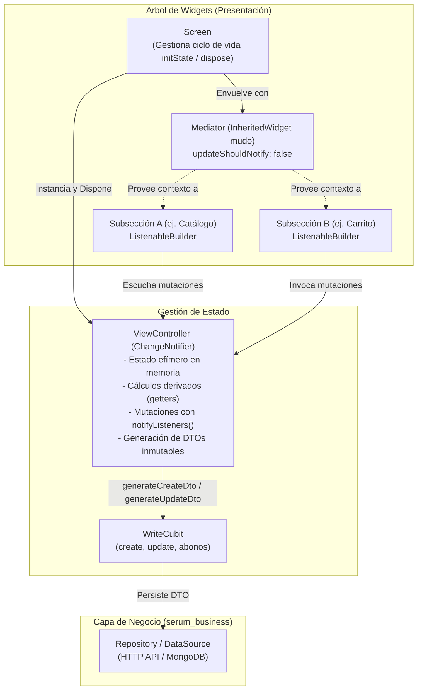

# 🏛️ Patrón ViewController + Mediator (Estándar OKF v0.2)

El patrón **ViewController + Mediator** es la solución arquitectónica estándar del proyecto Serum App para la gestión de pantallas complejas con alto grado de interactividad, formularios extensos, carritos de venta y estado efímero en memoria.

---

## 🎯 1. Problema que Resuelve

En pantallas simples de catálogo (ej. CRUDs básicos como pacientes o médicos), el patrón estándar de 3 clases (`Screen` $\to$ `_RootScaffold` $\to$ `_BodyState`) o diálogos pequeños es suficiente.

Sin embargo, en pantallas con flujos de trabajo extensos (como `CreateOrderScreen`, `CreateQuotationScreen` o `LabTestFormScreen`), el enfoque tradicional monolítico presenta serios problemas de mantenibilidad:
1. **Prop-Drilling Excesivo**: Componentes hijos como `OrderCartSection` o `QuotationCartSection` terminaban recibiendo entre 16 y 20 parámetros en su constructor (listas, controladores, callbacks de precios, banderas de descuento, etc.).
2. **Redibujados Globales Involuntarios**: El uso de `setState()` en la raíz redibujaba toda la pantalla completa (catálogo, filtros, barra superior y carrito) ante cualquier cambio mínimo (como teclear una letra en un buscador o cambiar una opción).
3. **Fuga de Lógica en la UI**: El cálculo de subtotales, impuestos, descuentos, redondeo de centavos o validaciones comerciales quedaba disperso en métodos `build()` de los widgets.
4. **Acoplamiento de Controladores de Texto**: Múltiples `TextEditingController` dispersos en el árbol de widgets provocaban fugas de memoria (*memory leaks*) por falta de un ciclo de vida `dispose()` centralizado.

---

## 🧩 2. Componentes del Patrón

El patrón descompone la pantalla en cuatro capas con responsabilidades delimitadas y unidireccionales:



### A. El Controlador de Vista (`ViewController`)
Es una clase pura de Dart que hereda de `ChangeNotifier`:
- **Estado Efímero**: Mantiene las entidades seleccionadas (paciente, médico), ítems agregados, listas de parámetros, controladores de texto (`TextEditingController`) y banderas de configuración.
- **Cálculos y Derivados**: Centraliza getters para montos totales, subtotales, descuentos, cálculo de ahorros, estado de validación (`isValid`, `isEmpty`) y nombres consolidados.
- **Mutaciones Reactivas**: Expone métodos de negocio de la vista (`addItem`, `removeItem`, `setDiscount`, `clearCart`) que actualizan el estado interno y ejecutan `notifyListeners()`.
- **Generación de DTOs de Dominio**: Transforma el estado interno en objetos inmutables listos para la API (`generateCreateOrder`, `generateCreateQuotation`, `generateCreateDto`).
- **Limpieza de Recursos**: Implementa `dispose()` liberando todos los `TextEditingController` y listeners locales.

### B. El Mediador (`Mediator`)
Es un `InheritedWidget` mudo con `updateShouldNotify: false`:
- **Propagación Limpia**: Permite a cualquier widget descendiente acceder al controlador mediante `Mediator.of(context)` o `Mediator.controllerOf(context)` sin requerir prop-drilling en constructores.
- **Aislamiento de Redibujados**: Al retornar siempre `false` en `updateShouldNotify`, el mediador **nunca redibuja el árbol de forma indiscriminada**.

### C. La Pantalla Raíz (`Screen`)
- Inicializa el `ViewController` en `initState()` y lo desecha en `dispose()`.
- Envuelve el árbol del `Scaffold` dentro del `Mediator`.
- Escucha los estados del `WriteCubit` (mediante `BlocListener` o `BlocConsumer`) para feedback contextual (SnackBars, navegación o visores PDF).

### D. Subsecciones y Widgets Hijos
- No reciben datos de estado en sus constructores. Su constructor únicamente acepta callbacks para acciones de UI modal (ej. `onSelectPatient`, `onSelectDoctor`, `onSubmit`).
- Consumen el controlador directamente desde el mediador.
- Utilizan `ListenableBuilder(listenable: controller, builder: ...)` para suscribirse a los cambios y redibujar únicamente la región visual que realmente depende de esos datos.

---

## 🚫 3. La Regla de Oro (Golden Rule)

> [!IMPORTANT]
> **Nunca inyectar el `ViewController` en el `Cubit`.**
> Los Cubits pertenecen a la capa de aplicación/negocio; los `ViewController` pertenecen a la capa de presentación de la pantalla. El Cubit **solo debe recibir DTOs inmutables** (ej. `CreateOrder`, `CreateQuotation`, `CreateLabTest`) generados por el método exportador del controlador (`controller.generateCreateXxx()`).

| Capa | Responsabilidad | ¿Conoce a la otra? |
| :--- | :--- | :--- |
| **`ViewController`** | Estado efímero de UI, textos de inputs, selección temporal, armado de DTO | Conoce los modelos DTO de dominio, pero **NO** ejecuta peticiones HTTP ni administra estados de sesión. |
| **`WriteCubit`** | Estado asíncrono (`Initial`, `Loading`, `Success`, `Error`), invocación de repositorios | Recibe **únicamente el DTO inmutable** como parámetro en sus métodos (`create(dto)`). Desconoce por completo los widgets y el ViewController. |

---

## 💻 4. Ejemplos de Implementación en Producción

### Caso 1: Órdenes Médicas (`CreateOrderViewController` & `CreateOrderMediator`)
- **Ubicación**: `lib/src/modules/order/controllers/`
- **Responsabilidad**:
  - Manejo de paciente seleccionado (`PatientInDb`), médico remitente (`DoctorInDb`), análisis agregados (`List<OrderItem>`), precios personalizados y descuentos.
  - Gestión de servicios adicionales libres (`List<OrderService>`) y notas clínicas.
  - Detección de necesidad de aprobación de supervisor (`requiresSupervisorApproval`) si se alteran precios con nivel de acceso $\le 3$.
  - Método exportador: `generateCreateOrder({required String branchId, required String cashRegisterId, required String operatorId})` que emite un snapshot inmutable de paciente, doctor e ítems.

### Caso 2: Cotizaciones Rápidas (`CreateQuotationViewController` & `CreateQuotationMediator`)
- **Ubicación**: `lib/src/modules/quotation/controllers/`
- **Responsabilidad**:
  - Control de cliente flexible: resuelve si la cotización corresponde a un paciente formal o a un cliente casual ingresado en `casualClientNameController` (fallback a `"Cliente General"`).
  - Manejo de tarifas P1 (Público) y P2 (Especial/Aseguradora) tanto global como individual por análisis.
  - Método exportador: `generateCreateQuotation({required String branchId, String? createdBy})`.

### Caso 3: Formulario Maestro de Pruebas Clínicas (`LabTestFormViewController` & `LabTestFormMediator`)
- **Ubicación**: `lib/src/modules/lab_test/controllers/`
- **Responsabilidad**:
  - Centraliza 10 controladores `TextEditingController` para nombres, códigos, precios comerciales y valores de referencia.
  - Soporte bidireccional de creación y edición (`isEdit`, precarga de datos).
  - Autocalculado del precio de packs basado en la sumatoria de pruebas hijas (`useChildTestsPriceSum`).
  - Métodos exportadores: `generateCreateDto({required String branchId})` y `generateUpdateDto({required String branchId})`.

### Caso 4: Administración Integral de Sucursales (`BranchFormViewController` & `BranchFormMediator`)
- **Ubicación**: `lib/src/modules/branch/controllers/`
- **Responsabilidad**:
  - Desacopla el formulario más grande del frontend (~1,311 líneas originales) a un orquestador declarativo (< 250 líneas) y 4 subsecciones modulares en `widgets/sections/`.
  - Centraliza 9 controladores de texto con `dispose()` riguroso (`name`, `address`, `city`, `phone`, `email`, `facebook`, `bioanalystName`, `bioanalystTitle`, `bioanalystCode`).
  - Administra el estado y subida de 3 activos binarios (Logo, IsoLogo y Sello de tinta) con banderas reactivas e invalidación de caché (`AppImageCache.evict`).
  - Mantiene la colección en memoria de bioanalistas auxiliares (`List<AuxBioanalyst>`) con mutaciones reactivas.
  - Métodos exportadores: `generateCreateDto({ImageUploadFunction? uploader})` y `generateUpdateDto({ImageUploadFunction? uploader})`, permitiendo inyección de funciones mock para pruebas unitarias sin red.

---

## ⚡ 5. Plantilla Canónica de Implementación

### Estructura de Archivos
```
lib/src/modules/<modulo>/
├── controllers/
│   ├── <nombre>_view_controller.dart
│   └── <nombre>_mediator.dart
├── view/
│   └── <nombre>_screen.dart
└── widgets/
    └── sections/
        ├── <nombre>_catalog_section.dart
        └── <nombre>_cart_section.dart
```

### Implementación del Mediator
```dart
class MyFeatureMediator extends InheritedWidget {
  final MyFeatureViewController controller;

  const MyFeatureMediator({
    super.key,
    required this.controller,
    required super.child,
  });

  static MyFeatureViewController of(BuildContext context) {
    final mediator = context.dependOnInheritedWidgetOfExactType<MyFeatureMediator>();
    assert(mediator != null, 'No se encontró MyFeatureMediator en el árbol de widgets.');
    return mediator!.controller;
  }

  static MyFeatureViewController controllerOf(BuildContext context) {
    final mediator = context.getInheritedWidgetOfExactType<MyFeatureMediator>();
    assert(mediator != null, 'No se encontró MyFeatureMediator en el árbol de widgets.');
    return mediator!.controller;
  }

  @override
  bool updateShouldNotify(covariant InheritedWidget oldWidget) => false;
}
```

### Implementación del ViewController
```dart
class MyFeatureViewController extends ChangeNotifier {
  // 1. Estado en memoria
  final List<Item> _items = [];
  final TextEditingController notesController = TextEditingController();

  List<Item> get items => List.unmodifiable(_items);
  int get totalAmount => _items.fold(0, (sum, item) => sum + item.price);
  bool get isEmpty => _items.isEmpty;

  // 2. Mutaciones con notificación reactiva
  void addItem(Item item) {
    _items.add(item);
    notifyListeners();
  }

  void removeItem(String id) {
    _items.removeWhere((item) => item.id == id);
    notifyListeners();
  }

  // 3. Generación de DTO inmutable
  CreateMyFeatureDto generateCreateDto({required String branchId}) {
    if (isEmpty) {
      throw StateError('No se pueden generar DTOs con la lista vacía.');
    }
    return CreateMyFeatureDto(
      branchId: branchId,
      items: _items,
      notes: notesController.text.trim(),
      total: totalAmount,
    );
  }

  // 4. Liberación de memoria
  @override
  void dispose() {
    notesController.dispose();
    super.dispose();
  }
}
```

### Consumo Granular con `ListenableBuilder` en Widgets Hijos
```dart
class MyCartSection extends StatelessWidget {
  final VoidCallback onSubmit;

  const MyCartSection({required this.onSubmit, super.key});

  @override
  Widget build(BuildContext context) {
    final controller = MyFeatureMediator.of(context);

    return ListenableBuilder(
      listenable: controller,
      builder: (context, _) {
        return Column(
          children: [
            Text('Total: \$${controller.totalAmount / 100}'),
            ElevatedButton(
              onPressed: controller.isEmpty ? null : onSubmit,
              child: const Text('Confirmar'),
            ),
          ],
        );
      },
    );
  }
}
```

---

## 🧪 6. Guía de Pruebas Automatizadas

El desacoplamiento del patrón permite probar la lógica de las pantallas de forma unitaria y ultra rápida:

1. **Pruebas Unitarias Puras (`test/modules/<modulo>/<nombre>_view_controller_test.dart`)**:
   - Prueban `addItem`, `removeItem`, validaciones, getters derivados y la generación de DTOs sin inicializar widgets de Flutter ni cargar contextos de UI.
2. **Pruebas de Widgets Integradas (`test/modules/<modulo>/<nombre>_screen_test.dart`)**:
   - Montan la pantalla dentro de los repositorios falsos y verifican la reactividad visual del carrito y catálogo cuando el usuario interactúa.
